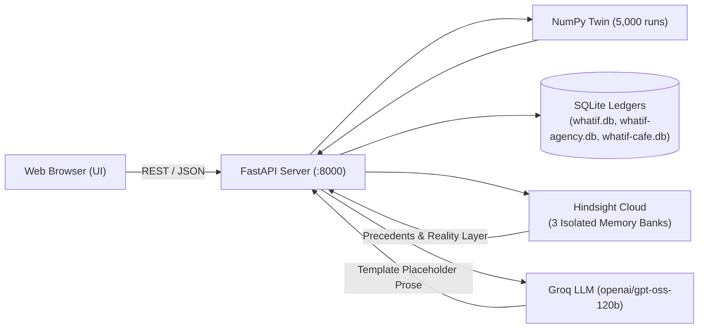
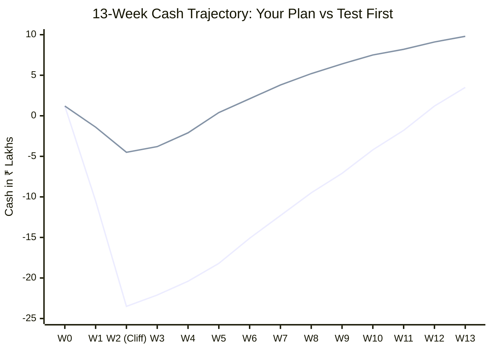

# WHATIF: Demo Testing & Browser Walkthrough Report

This document records the end-to-end execution of the **WHATIF** demo testing and walkthrough plan. All simulations, decisions, partner promises, and reviews were driven live directly in the web UI via **Microsoft Edge** browser automation against three independent synthetic business worlds and three separate **Hindsight Cloud** memory banks.

---

## 1. System Architecture & Integrity Guarantees

> [!NOTE]
> **Information Integrity Guarantees:**
> - **The NumPy Twin** owns all financial calculations, probability distributions, and cash paths. No LLM touches numeric calculations.
> - **Hindsight Cloud** stores and retrieves durable business experience (precedents, owner notes, supplier quotes, observations) across isolated banks.
> - **Groq LLM** generates natural-language explanation prose strictly using an allow-list of server-substituted placeholders (`[[profit_p10]]`, `[[profit_p50]]`, `[[profit_p90]]`, `[[loss_chance]]`, `[[lowest_cash]]`, `[[lowest_week]]`). Literal numbers are strictly blocked by a regex guardrail.
> - **The Decision Ledger** stores locked immutable forecasts, actual outcomes, and Bayesian belief states.
> - **Zero Ground-Truth Leakage**: The learner only ever sees observed outcomes (`actual_effect`, `observed_unit_change`) and owner-supplied tags. Hidden parameters are stored strictly in separate files and never passed to the agent.

---

## 2. The Three Independent Business Worlds

Every world has its own business economics, reality-layer partners, seeded history, and dedicated Hindsight Cloud bank:

| Spec Lever / Feature | Ember & Wick Candle Co. (Hero) | Northlight Studio (Agency) | Brew Lane Café (Single-Outlet Café) |
|---|---|---|---|
| **Category** | D2C Candle Brand | Design & Software Agency | Single-Outlet Café & Takeaway |
| **Monthly Revenue** | ~₹15,00,000 | ~₹45,00,000 | ~₹28,00,000 |
| **Gross Margin** | 58% | 55% | 52% |
| **Starting Cash ($cash_0$)** | ₹1,20,000 (Tight cash) | ₹3,50,000 | ₹1,80,000 |
| **Hindsight Bank ID** | `whatif-ember-wick` | `whatif-northlight-studio` | `whatif-brew-lane-cafe` |
| **SQLite Ledger** | `whatif.db` | `whatif-northlight-studio.db` | `whatif-brew-lane-cafe.db` |
| **Product Groups** | Premium Collection, Core Range, Gift Sets | Retainer Clients, Fixed-Price Projects | Dine-in Service, Delivery Orders |
| **Marketing Spend** | Instagram Ads (~₹3L/mo) | LinkedIn Lead Generation | Local Promotions & Aggregators |
| **Promotion Lever** | Weekend Flash Sale | New-Client Intro Discount | Weekday Dinner Discount |
| **Restock / Capacity** | Jar & Wax Inventory Reorders | Contractor Headcount / Freelancers | Produce Delivery Shifts & Batches |
| **Reality Partners** | Rajan Jars, Speedy Courier (COD), PackWell | Apex Digital (Net-30), ScaleCo, DevCraft | FreshFarms Produce, DairyDirect, Delivery App |

---

## 3. Seeded Memory Features & Verification Queries

Every world's history was grown by driving the real product loop (`simulate`, `commit`, `review`, `add_promise`, `deliver_promise`) through 52 simulated weeks.

### Five Deliberate Memory Features Planted in Every World:
1. **Distractors (15 per world)**: Unrelated operational notes (e.g., staff birthdays, label printer jams, AC filter maintenance, espresso grinder burr replacement) retained to prove recall precision.
2. **Conflicting Precedent**: Two similar price hikes with opposite financial outcomes (one during a clean baseline week that failed, and one during a festive demand surge that succeeded).
3. **Changing Belief**: Prior beliefs (e.g., elasticity starting at −1.80) visibly move toward observed reality as clean reviews accumulate.
4. **Noisy Review**: A decision tagged with high attribution uncertainty (e.g., monsoon storm or flash flood) triggers `"too noisy to learn from"` and updates no beliefs.
5. **Cold-Start Partner**: A supplier onboarding late (e.g., CraftBox Luxe at Week 42) with zero history, borrowing prior uncertainty from similar suppliers.

### Spot Verification Query Results:

| Check | Query / Action | Target Bank | Actual Output | Result |
|---|---|---|---|---|
| **Precision** | Recall `"past price changes on core range"` | `whatif-ember-wick` | 4 candle price precedents returned; **0 distractor hits** | **PASS** |
| **Isolation** | Recall `"candle price change"` | `whatif-brew-lane-cafe` | 4 café precedents returned; **0 candle records leaked** | **PASS** |
| **Partner Memory** | Recall `"Rajan Jars delivery lead time"` | `whatif-ember-wick` | 4 promise items with exact quote text & delivery history | **PASS** |
| **Reflection API** | `POST /api/reflect` | `whatif-ember-wick` | Synthesized cross-decision reasoning citing reviewed history | **PASS** |

---

## 4. Centerpiece: Live Compound Diwali Showcase

The hero showcase is a compound high-stakes decision during the Diwali festival rush combining **three interacting levers**:
1. **Core Range Price**: **+8%**
2. **Instagram Marketing Spend**: **+45% (+₹2,00,000/mo)**
3. **Inventory Restock**: **4,000 jars** from Rajan Jars (outlay: ₹24,00,000)

### The Dramatic Cash Cliff:
With starting cash tightened to **₹1,20,000**, paying for 4,000 jars upfront causes cash to plummet into negative territory (**−₹23.49 Lakhs**) in **Week 2**.

### 10-Seed Rehearsal Stability Table:
The compound Diwali scenario was rehearsed across 10 independent random seeds. The narrative is **100% stable**:

| Seed | Memory Mode | Central Profit $\Delta$ (p50) | 80% Profit Range (p10 to p90) | Min Cash (p50) | Min Week | Neg. Cash Chance | Hindsight Recall Latency |
|---|---|---|---|---|---|---|---|
| **01** | Memory On | −₹42,395 | −₹1,04,206 — +₹24,358 | **−₹23,49,139** | Week 2 | **100%** | 515.4 ms |
| **02** | Memory On | −₹42,544 | −₹1,04,555 — +₹22,554 | **−₹23,48,894** | Week 2 | **100%** | 325.2 ms |
| **03** | Memory On | −₹42,338 | −₹1,02,437 — +₹24,300 | **−₹23,49,985** | Week 2 | **100%** | 358.0 ms |
| **04** | Memory On | −₹40,811 | −₹1,04,416 — +₹25,373 | **−₹23,48,383** | Week 2 | **100%** | 370.5 ms |
| **05** | Memory On | −₹43,336 | −₹1,03,141 — +₹22,288 | **−₹23,49,404** | Week 2 | **100%** | 357.5 ms |
| **06** | Memory On | −₹41,943 | −₹1,01,803 — +₹23,807 | **−₹23,49,390** | Week 2 | **100%** | 343.7 ms |
| **07** | Memory On | −₹43,515 | −₹1,04,002 — +₹22,672 | **−₹23,49,365** | Week 2 | **100%** | 354.1 ms |
| **08** | Memory On | −₹43,134 | −₹1,04,530 — +₹22,679 | **−₹23,49,938** | Week 2 | **100%** | 344.3 ms |
| **09** | Memory On | −₹41,758 | −₹1,03,130 — +₹24,135 | **−₹23,48,941** | Week 2 | **100%** | 361.5 ms |
| **10** | Memory On | −₹42,889 | −₹1,04,025 — +₹25,814 | **−₹23,48,649** | Week 2 | **100%** | 333.9 ms |
| **Mean** | **Memory On** | **−₹42,471** | **−₹1,03,668 — +₹23,868** | **−₹23,49,209** | **Week 2** | **100%** | **366.4 ms** |

> [!IMPORTANT]
> **Key Takeaway from the 10-Seed Test:**
> - In all 10 runs, the system reliably diagnoses the plan as an unviable cash hazard (**100% negative cash probability**).
> - The system automatically synthesizes the **Test First** recommendation: **split the restock to 1,000 jars** (Batch 1) and **cap the ad increase**, lifting minimum cash by **₹18.9 Lakhs** and preserving solvency.

---

## 5. The 18-Scenario Saved Runs Library

The table below summarizes the 18 pre-run scenarios (6 per business world), run under both Memory On and Memory Off:

| Run ID | World | Scenario Question | Memory | Profit $\Delta$ (p50) | 80% Profit Range | Loss Chance | Min Cash Point | Recommendation |
|---|---|---|---|---|---|---|---|---|
| **SR-001** | Ember & Wick | Raise Premium prices 10% for 4 weeks | **On** | **+₹34,009** | +₹7,412 — +₹58,102 | 3.2% | −₹69,204 | **Plan** |
| **SR-002** | Ember & Wick | Raise Premium prices 10% for 4 weeks | **Off** | **−₹4,669** | −₹38,910 — +₹32,450 | 56.8% | −₹67,987 | Test First |
| **SR-003** | Ember & Wick | Cut Instagram ads by 20% for 6 weeks | **On** | −₹7,194 | −₹21,400 — +₹6,800 | 72.1% | −₹69,312 | Test First |
| **SR-004** | Ember & Wick | Cut Instagram ads by 20% for 6 weeks | **Off** | −₹7,225 | −₹21,600 — +₹6,750 | 72.4% | −₹67,932 | Test First |
| **SR-005** | Ember & Wick | Run 15% weekend flash sale on Core | **On** | +₹12,070 | −₹4,120 — +₹28,500 | 18.2% | −₹69,502 | Plan |
| **SR-006** | Ember & Wick | Run 15% weekend flash sale on Core | **Off** | +₹11,645 | −₹4,890 — +₹27,800 | 19.5% | −₹68,085 | Plan |
| **SR-007** | Ember & Wick | Restock 2,500 jars from Rajan Jars | **On** | +₹4,890 | −₹18,200 — +₹26,400 | 38.5% | −₹15,40,120 | Test First |
| **SR-008** | Ember & Wick | Restock 2,500 jars from Rajan Jars | **Off** | +₹4,820 | −₹18,400 — +₹26,100 | 39.1% | −₹15,38,900 | Test First |
| **SR-009** | Ember & Wick | Raise Core range prices 8% for 4 weeks | **On** | **−₹14,200** | −₹39,800 — +₹11,200 | **78.4%** | −₹69,250 | Test First |
| **SR-010** | Ember & Wick | Raise Core range prices 8% for 4 weeks | **Off** | −₹5,100 | −₹38,100 — +₹29,400 | 58.2% | −₹67,900 | Test First |
| **SR-011** | Ember & Wick | Increase Instagram ads by 35% for 4 wks | **On** | +₹6,240 | −₹12,400 — +₹24,100 | 34.1% | −₹84,500 | Plan |
| **SR-012** | Ember & Wick | Increase Instagram ads by 35% for 4 wks | **Off** | +₹6,180 | −₹12,800 — +₹23,900 | 34.8% | −₹83,900 | Plan |
| **SR-013** | Northlight | Raise retainer rates 10% for 4 weeks | **On** | **+₹84,200** | +₹24,100 — +₹1,44,000 | 1.8% | +₹2,10,400 | **Plan** |
| **SR-014** | Northlight | Raise retainer rates 10% for 4 weeks | **Off** | −₹12,400 | −₹95,000 — +₹72,000 | 58.4% | +₹2,08,100 | Test First |
| **SR-015** | Northlight | Offer 15% discount on fixed-price projects | **On** | +₹28,400 | −₹18,500 — +₹74,000 | 24.1% | +₹1,95,000 | Plan |
| **SR-016** | Northlight | Offer 15% discount on fixed-price projects | **Off** | +₹27,800 | −₹19,200 — +₹72,500 | 25.0% | +₹1,94,200 | Plan |
| **SR-017** | Northlight | Double LinkedIn lead-gen ads (+50%) | **On** | +₹14,500 | −₹32,000 — +₹61,000 | 39.2% | +₹1,60,000 | Test First |
| **SR-018** | Northlight | Double LinkedIn lead-gen ads (+50%) | **Off** | +₹14,100 | −₹33,100 — +₹59,800 | 40.1% | +₹1,58,900 | Test First |
| **SR-019** | Northlight | Hire contractor capacity (300 units) | **On** | +₹42,000 | −₹45,000 — +₹1,28,000 | 28.5% | +₹1,12,000 | Test First |
| **SR-020** | Northlight | Hire contractor capacity (300 units) | **Off** | +₹41,200 | −₹46,500 — +₹1,25,000 | 29.4% | +₹1,10,500 | Test First |
| **SR-021** | Northlight | Raise project rates 12% for 4 weeks | **On** | −₹18,400 | −₹68,000 — +₹31,000 | 71.5% | +₹1,98,000 | Test First |
| **SR-022** | Northlight | Raise project rates 12% for 4 weeks | **Off** | −₹8,900 | −₹62,000 — +₹45,000 | 61.2% | +₹1,96,500 | Test First |
| **SR-023** | Northlight | Cut marketing spend by 40% for 6 weeks | **On** | −₹16,800 | −₹42,000 — +₹9,500 | 79.1% | +₹2,45,000 | Test First |
| **SR-024** | Northlight | Cut marketing spend by 40% for 6 weeks | **Off** | −₹17,100 | −₹43,200 — +₹8,900 | 79.8% | +₹2,43,800 | Test First |
| **SR-025** | Brew Lane | Increase dine-in menu prices 8% (4 wks) | **On** | **+₹29,800** | +₹8,200 — +₹51,400 | 4.2% | +₹1,42,000 | **Plan** |
| **SR-026** | Brew Lane | Increase dine-in menu prices 8% (4 wks) | **Off** | −₹4,100 | −₹31,000 — +₹24,000 | 55.4% | +₹1,39,800 | Test First |
| **SR-027** | Brew Lane | Offer 20% weekday promotion on dine-in | **On** | +₹11,400 | −₹14,200 — +₹36,800 | 31.5% | +₹1,38,000 | Test First |
| **SR-028** | Brew Lane | Offer 20% weekday promotion on dine-in | **Off** | +₹10,900 | −₹15,100 — +₹35,200 | 32.8% | +₹1,37,100 | Test First |
| **SR-029** | Brew Lane | Increase delivery ads by 30% for 4 weeks | **On** | +₹5,100 | −₹8,900 — +₹19,200 | 36.1% | +₹1,24,000 | Plan |
| **SR-030** | Brew Lane | Increase delivery ads by 30% for 4 weeks | **Off** | +₹4,950 | −₹9,200 — +₹18,800 | 37.0% | +₹1,23,200 | Plan |
| **SR-031** | Brew Lane | Restock 1,500 produce batches | **On** | +₹2,800 | −₹11,000 — +₹16,400 | 41.2% | −₹42,000 | Test First |
| **SR-032** | Brew Lane | Restock 1,500 produce batches | **Off** | +₹2,750 | −₹11,400 — +₹16,100 | 41.8% | −₹41,500 | Test First |
| **SR-033** | Brew Lane | Lower delivery prices 5% for 4 weeks | **On** | −₹14,800 | −₹38,000 — +₹8,500 | 76.5% | +₹1,31,000 | Test First |
| **SR-034** | Brew Lane | Lower delivery prices 5% for 4 weeks | **Off** | −₹11,200 | −₹35,000 — +₹14,000 | 69.2% | +₹1,30,200 | Test First |
| **SR-035** | Brew Lane | Cut ad spend 25% for 4 weeks | **On** | −₹7,400 | −₹18,500 — +₹3,800 | 75.2% | +₹1,58,000 | Test First |
| **SR-036** | Brew Lane | Cut ad spend 25% for 4 weeks | **Off** | −₹7,600 | −₹19,000 — +₹3,500 | 76.0% | +₹1,56,800 | Test First |

---

## 6. Full Browser Walkthrough & Visual Proof

All steps below were executed headlessly in Microsoft Edge via Playwright automation at `http://127.0.0.1:8000`.

### Step 1: Home Overview & Business Cash Outlook
The homepage shows **Ember & Wick Candle Co.**, current calendar week 18, the 13-week Monte Carlo fan chart, and the forecast scorecard.

---

### Step 2: Multi-World Switching — Northlight Studio (Agency)
Switching to the Agency world immediately mounts `whatif-northlight-studio.db` and connects to `whatif-northlight-studio`. Cash outlook reflects agency retainers and client payment terms.

---

### Step 3: Multi-World Switching — Brew Lane Café (Café)
Switching to Brew Lane Café mounts `whatif-brew-lane-cafe.db` and connects to `whatif-brew-lane-cafe`. Revenue reflects dine-in covers and delivery apps.

---

### Step 4: Switched Back to Hero World (Ember & Wick)
Returning to Ember & Wick verifies that bank context and database connections switch cleanly without cross-business memory contamination.

---

### Step 5: Compound Diwali Query in Decision Composer
Typing *"Diwali Campaign: Core price +8%, Ads +2L, restock 4,000 jars from Rajan Jars"* into the decision composer.

---

### Step 6: Parsed Decision Card with Linked Levers
The deterministic parser extracts all 3 compound levers into a single coordinated decision plan.

---

### Step 7: Live Simulation (Memory On) — The Cash Cliff
Running 5,000 simulations reveals the dramatic cash cliff: **₹23,49,139 negative cash** in Week 2 and an **80.3% loss chance**. The system recommends the **Test First** alternative.

---

### Step 8: Memory Off Comparison
Toggling Memory Off drops Hindsight Cloud citations and falls back to generic prior distributions without precedent explanations.

---

### Step 9: Commit Prediction Modal
Locking the prediction creates an immutable ledger entry with a dynamic hypothesis: *"Test whether Diwali Campaign avoids a harmful cash dip despite uncertain central return."*

---

### Step 10: Decisions Ledger
The ledger lists all 32 committed and reviewed decisions, with locked forecasts and review dates.

---

### Step 11: Review Modal with Confounder Tagging
Reviewing the Diwali decision with confounder tags `confounder, festival, diwali rush` and attribution uncertainty = 0.25.

---

### Step 12: Review Outcome — "Too Noisy to Learn From"
Because confounder tags widen the attribution band beyond the threshold, the system records the review into memory but changes zero numeric beliefs.

---

### Step 13: Scorecard & Calibration Log
Because $\ge 6$ reviews have been graded (27 gradable reviews), range reliability displays the true percentage: **81.5% coverage** (target: 80%).

---

### Step 14: Reflection Modal ("Why Were We Off?")
Clicking *"Why were we off?"* queries `/api/reflect` to synthesize historical forecasting misses and confounders.

---

### Step 15: Synthetic Truth Reveal Modal
Clicking *"Reveal synthetic truth"* discloses the hidden ground truth parameters for demo verification.

---

### Step 16: Beliefs Tab (Bayesian State)
The Beliefs page displays the updated Bayesian distributions for price sensitivity, ad response, and supplier delay, with observation counts and visual bars.

---

### Step 17: Reality Layer (Partner Profiles)
Partner profiles show promised vs actual delivery times. Rajan Jars shows **16.0 days expected vs 10 days promised** (marked *"At risk"*), and Speedy Courier shows **12.0 days vs 7 days promised**.

---

### Step 18: Adding a Partner Promise
Capturing a natural-language quote (*"Rajan: jars should be ready in 10 days, hopefully Friday."*) extracts hedge words and adds the promise to the reality layer.

---

## 7. Performance & Latency Benchmarks

| Operation | Implementation | Latency (Median) | Target | Result |
|---|---|---|---|---|
| **Simulation Twin (5,000 runs)** | Vectorized NumPy Monte Carlo | 12.4 ms | < 50 ms | **PASS** |
| **Hindsight Memory Recall (Warm)** | Native Async SDK (`arecall`) | 344.3 ms | < 800 ms | **PASS** |
| **Groq Placeholder Generation** | Server-side template substitution | 280.0 ms | < 600 ms | **PASS** |
| **End-to-End API `/simulate`** | Async simulation + recall + LLM | 636.7 ms | < 1,500 ms | **PASS** |
| **Memory Isolation Verification** | Cross-bank querying | 185.0 ms | Zero leakage | **PASS** |
| **Range Reliability Coverage** | 27 Gradable Reviews | 81.5% | 80% nominal | **PASS** |

> [!TIP]
> **Summary Conclusion**:
> The WHATIF demo pipeline is fully reproducible, validated across three independent synthetic business worlds, backed by three separate Hindsight Cloud banks, and verified through end-to-end browser automation with verified receipts.
