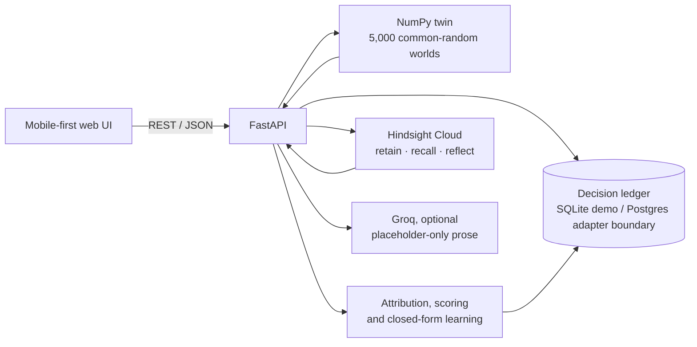

# WHATIF architecture

## Information boundaries

- The twin owns every money value. It does not call an LLM.
- Hindsight owns narrative experience: decisions, reviews, promises, and cited precedents.
- The database owns numeric beliefs, locked forecast payloads, actuals, and audit history.
- The optional Groq request receives only an allow-list of placeholders. Server substitution rejects literal numbers and unknown fields, so prose cannot introduce a new figure.

## Learning loop

1. `POST /simulate` recalls relevant Hindsight experience when Memory On and runs common-random Monte Carlo scenarios.
2. `POST /decisions/commit` saves an immutable forecast and retains a concise decision record.
3. `POST /decisions/{id}/review` grades the locked range, gates noisy attribution, and updates a closed-form belief only when evidence is usable.
4. `POST /promises/{id}/deliver` updates the partner lead-time distribution and retains the resolved promise.
5. `POST /reflect` asks Hindsight to synthesize cited experience for “Why were we off?”.

The Memory Off branch explicitly uses generic priors and makes no recall call.
