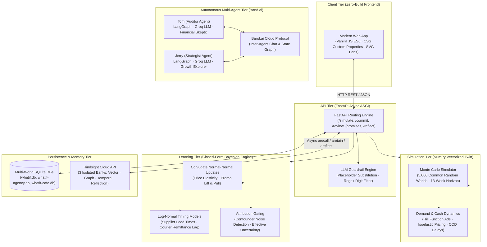

# WHATIF · Architecture & Technical Deep Dive

This document details the engineering architecture, mathematical models, boundary invariants, memory ontology, and agent protocols of **WHATIF**.

---

## 1. System Topology & Architectural Invariants

WHATIF is architected around strict separation of concerns: **Deterministic math owns all financial calculations; Hindsight Cloud owns durable narrative experience; SQLite owns persistent transactional state; Groq LLM generates template prose under strict regex guardrails; and Band.ai powers autonomous peer agents.**



### The Five Inviolable System Invariants:
1. **The Math Invariant**: No LLM ever generates, alters, or touches a financial calculation, probability distribution, or cash balance. All money figures originate strictly from the NumPy simulation engine.
2. **The Guardrail Invariant**: LLM prose generation uses an allow-list of server-substituted placeholders (`[[profit_p10]]`, `[[profit_p50]]`, `[[profit_p90]]`, `[[loss_chance]]`, `[[lowest_cash]]`, `[[lowest_week]]`). Literal numbers in LLM responses trigger an immediate exception and fall back to deterministic templates.
3. **The Zero Ground-Truth Leakage Invariant**: The Bayesian learner receives only observed outcomes (`actual_effect`, `observed_unit_change`) and owner-tagged confounders. Hidden world parameters (true elasticity, hidden saturation points, supplier delay factors) are kept strictly out of the learner's scope.
4. **The Attribution Gating Invariant**: When external noise or confounders widen attribution uncertainty beyond threshold ($\text{effective\_uncertainty} > 0.20$), the system records the review but changes zero numeric beliefs (`learned = False`).
5. **The Memory Isolation Invariant**: Each business world operates on an isolated SQLite database and a dedicated Hindsight Cloud bank. No memory, promise, or decision ever leaks across bank boundaries.

---

## 2. Tech Stack & Engineering Rationale

| Layer | Technology | Version | Rationale & Tradeoffs |
|---|---|---|---|
| **Backend Framework** | **FastAPI** | 0.115+ | Native async ASGI, automatic OpenAPI documentation, ultra-low serialization overhead. |
| **Numerical Twin** | **NumPy** | 1.26+ | Vectorized array operations execute 5,000 13-week Monte Carlo simulation paths in under 15ms. |
| **Transactional DB** | **SQLite (WAL mode)** | 3.x | Zero-configuration persistence, file-based multi-world isolation (`whatif.db`), ACID compliance without external database server overhead. |
| **Experience Memory** | **Hindsight Cloud** | 0.4.x | Cloud-native associative memory combining dense vector search, temporal decay retrieval, knowledge graphs, and reflection synthesis. |
| **Prose LLM** | **Groq Cloud API** | OpenAI SDK | High-throughput LPU inference running `openai/gpt-oss-120b` for sub-300ms template placeholder prose generation. |
| **Multi-Agent Pair** | **Band.ai + LangGraph** | Band 0.1+ | Autonomous agent communication over Band.ai cloud protocol with LangGraph state machines and role-specialized prompts. |
| **Browser Testing** | **Playwright** | 1.48+ | Headless Chromium / Edge automation for automated regression validation and high-resolution screenshot capture. |
| **Frontend Web** | **Vanilla ES6 / CSS3** | Modern DOM | Zero npm/webpack/vite build step. Pure native CSS custom properties, responsive grid, and inline SVG fan charts with zero external asset dependencies. |

---

## 3. Mathematical Foundations of the Business Twin

The simulation twin (`apps/api/whatif/simulator.py`) simulates $N = 5,000$ parallel futures across a 13-week planning horizon ($T = 13$) using Common Random Numbers (CRN) for variance reduction.

### 3.1. Demand Generation & Ad Saturation
For each product group $g$ at week $t$:
$$\text{BaseDemand}_{g,t} = \text{base\_units}_g \times \text{Seasonality}(t) \times \text{MacroLevel} \times \exp(\epsilon_{\text{demand}})$$
where $\epsilon_{\text{demand}} \sim \mathcal{N}(0, 0.065^2)$.

Demand is divided into organic and ad-driven components via baseline ad share $s_g$:
$$\text{Organic}_{g,t} = \text{BaseDemand}_{g,t} \times (1 - s_g)$$

Ad spend response follows a **Hill function** (S-curve saturation):
$$\text{Hill}(x, h, k) = \frac{x^h}{x^h + k^h}$$
$$\text{AdMultiplier}_{g,t} = \frac{\text{Hill}(\text{AdRatio}_{g,t}, h_g, k_g)}{\text{Hill}(1, h_g, k_g)}$$
$$\text{AdDemand}_{g,t} = \text{BaseDemand}_{g,t} \times s_g \times \text{AdMultiplier}_{g,t}$$

### 3.2. Isoelastic Pricing & Promotion Cannibalization
Price sensitivity follows an isoelastic demand formulation:
$$\text{PriceFactor}_{g,t} = (\text{PriceRatio}_{g,t})^{E_g}$$
where $E_g < 0$ is the Bayesian elasticity parameter for group $g$.

When a promotional discount $d_{g,t}$ is applied:
$$\text{PromoLift}_{g,t} = 1 + \text{PromoLiftCoeff}_g \times \frac{d_{g,t}}{0.10}$$
$$\text{Demand}_{g,t} = \max\left( (\text{Organic}_{g,t} + \text{AdDemand}_{g,t}) \times \text{PriceFactor}_{g,t} \times \text{PromoLift}_{g,t} - \text{PullForward}_{g,t}, 0 \right)$$

Promotions pull sales forward from future periods, modeled as an inventory drainage on weeks $t+1$ and $t+2$:
$$\text{PullForward}_{g, t+1} += \frac{1}{2} (\text{Demand}_{g,t} - \text{BaseDemand}_{g,t}) \times \text{PromoPullCoeff}_g$$

### 3.3. Inventory Dynamics & Supplier Delay
Units sold are bounded by available on-hand inventory:
$$\text{UnitsSold}_{g,t} = \min(\text{Demand}_{g,t}, \text{Inventory}_{g,t})$$
$$\text{StockoutLoss}_{g,t} = \text{Demand}_{g,t} - \text{UnitsSold}_{g,t}$$
$$\text{Inventory}_{g,t+1} = \text{Inventory}_{g,t} - \text{UnitsSold}_{g,t} + \text{Arrivals}_{g,t}$$

Supplier deliveries arrive after stochastic delay $D_{s,t}$:
$$D_{s,t} = \text{PromisedDays}_s \times \text{DelayRatio}_{s,t} / 7$$
$$\text{DelayRatio}_{s,t} \sim \text{LogNormal}(\mu_s, \sigma_s^2)$$
Arrivals are distributed across floor and ceiling weeks via linear fraction interpolation.

### 3.4. Cash Receipts & Courier COD Lag
Gross revenue:
$$\text{Revenue}_t = \sum_g \text{UnitsSold}_{g,t} \times \text{ActualPrice}_{g,t}$$

Prepaid sales $(1 - \text{COD\_share})$ settle immediately in week $t$. Cash-on-Delivery (COD) sales settle only after courier remittance delay $D_{\text{courier}, t}$:
$$\text{CashReceipts}_t = (1 - \text{COD\_share}) \text{Revenue}_t + \text{SettledCOD}_t$$

Cash balance evolution:
$$\text{Cash}_{t+1} = \text{Cash}_t + \text{CashReceipts}_t - \text{SupplierPayments}_t - \text{AdSpend}_t - \text{FixedWeeklyExpenses}$$

---

## 4. Closed-Form Bayesian Learning & Attribution Gating

WHATIF updates its beliefs without gradient descent or black-box neural networks. It uses **conjugate closed-form Bayesian updating** (`apps/api/whatif/beliefs.py` and `apps/api/whatif/learning.py`).

### 4.1. Price Elasticity Updating (Normal-Normal Conjugate Model)
Prior belief for elasticity $E \sim \mathcal{N}(\mu_0, \sigma_0^2)$.
When a clean price decision is reviewed with observed price change $\Delta p$ and measured unit change $\Delta u$:
$$\hat{E}_{\text{obs}} = \frac{\ln(1 + \Delta u)}{\ln(1 + \Delta p)}$$
Observation standard deviation is scaled by attribution uncertainty $\tau$:
$$\sigma_{\text{obs}} = \min(1.8, 0.45 + \tau \times 2.5)$$

Posterior distribution update:
$$\sigma_{\text{post}}^2 = \left( \frac{1}{\sigma_0^2} + \frac{1}{\sigma_{\text{obs}}^2} \right)^{-1}$$
$$\mu_{\text{post}} = \sigma_{\text{post}}^2 \left( \frac{\mu_0}{\sigma_0^2} + \frac{\hat{E}_{\text{obs}}}{\sigma_{\text{obs}}^2} \right)$$
$$\text{Observations Count: } n_{\text{post}} = n_0 + 1$$

### 4.2. Partner Timing Updates (Log-Normal Conjugate Model)
For partner delay ratio $R = \text{ActualDays} / \text{PromisedDays}$:
$$y = \ln(R)$$
Prior: $\mu \sim \mathcal{N}(\mu_0, \sigma_0^2)$.  
With observation $y$ and measurement noise $\sigma_y$:
$$\sigma_{\text{post}}^2 = \left( \frac{1}{\sigma_0^2} + \frac{1}{\sigma_y^2} \right)^{-1}$$
$$\mu_{\text{post}} = \sigma_{\text{post}}^2 \left( \frac{\mu_0}{\sigma_0^2} + \frac{y}{\sigma_y^2} \right)$$

If the promise quote contained hedge words (`"should be"`, `"hopefully"`), $\sigma_y$ is increased, widening the update corridor.

### 4.3. Attribution Gating (Noise Filtering)
Real businesses operate in volatile environments. If a holiday or flood occurs, attributing the outcome to a price hike is mathematically invalid.
$$\text{Effective Uncertainty } \tau_{\text{eff}} = \tau_{\text{base}} + 0.12 \times N_{\text{confounders}} + 0.04 \times N_{\text{tags}}$$
**Gating Rule**:
$$\text{If } \tau_{\text{eff}} > 0.20 \text{ or } N_{\text{tags}} \ge 2: \quad \text{Learned} = \text{False}$$
The outcome is logged in the Decisions ledger and retained in Hindsight Cloud, but **no numeric beliefs are updated**.

---

## 5. Hindsight Cloud Memory Architecture

Hindsight Cloud acts as the associative, long-term memory layer for WHATIF.

### 5.1. Bank Isolation Schema
Three dedicated banks are maintained:
* `whatif-ember-wick`: Ember & Wick Candle Co.
* `whatif-northlight-studio`: Northlight Studio
* `whatif-brew-lane-cafe`: Brew Lane Café

Bank configuration defines a skeptical, literalist disposition:
```python
await client.acreate_bank(
    bank_id=bank_id,
    name=f"WHATIF · {business_name}",
    mission="Act as the decision memory for this business. Never invent numbers. Cite the memories used and say when evidence is thin.",
    disposition={"skepticism": 0.9, "literalism": 0.9, "empathy": 0.2},
    enable_observations=True,
    enable_temporal_retrieval=True,
    enable_graph_retrieval=True,
    reflect_mission="Explain only from retrieved business experience. Do not change numeric beliefs."
)
```

### 5.2. Memory Tagging Ontology
Every retained memory is indexed with structured tags:
* **Decisions**: `["decision", "lever:{lever}", "group:{group}", "status:{committed|reviewed}"]`
* **Promises**: `["promise", "partner:{partner_key}", "status:{pending|resolved}", "hedged"|"firm"]`
* **Owner Notes & Distractors**: `["note", "operations", "distractor"]`

### 5.3. Memory Operations
1. **`aretain` / `aretain_batch`**: Retains locked predictions, reviewed actuals, raw quotes, and owner notes asynchronously with `update_mode="replace"`.
2. **`arecall`**: Retrieves relevant historical precedents during `/api/simulate` when Memory On is enabled. Filters out distractors via tag matching and semantic distance.
3. **`areflect`**: Synthesizes cross-decision insights for the *"Why were we off?"* modal, citing verified facts without fabricating numbers.

---

## 6. Groq LLM Guardrail Engine

The LLM is strictly constrained to prevent hallucinations:

```text
┌────────────────────────────────────────────────────────┐
│  NumPy Simulation Engine                               │
│  p10: -42000, p50: +18000, p90: +52000, loss: 0.18     │
└──────────────────────────┬─────────────────────────────┘
                           │ Allowed Placeholders
┌──────────────────────────▼─────────────────────────────┐
│  Groq API (gpt-oss-120b)                               │
│  "The plan produces [[profit_p50]] with [[loss_chance]]│
│   chance of worse off."                                │
└──────────────────────────┬─────────────────────────────┘
                           │ Regex Guardrail Check
┌──────────────────────────▼─────────────────────────────┐
│  Regex Substitution & Digit Validator                 │
│  1. Check: Does template contain literal digits?       │
│     If YES -> Reject template, fallback to deterministic│
│  2. Server replaces [[profit_p50]] -> "₹18,000"        │
└────────────────────────────────────────────────────────┘
```

### Guardrail Code Implementation (`apps/api/whatif/llm.py`):
```python
# Strip authorized placeholders (including digits like p10, p50, p90)
scrubbed = re.sub(r"\[\[([a-z0-9_]+)\]\]", "", template)

# Reject if the model emitted any literal un-substituted digits
if re.search(r"\b\d+\b", scrubbed):
    raise ValueError("Generated prose may not contain literal digits")
```

---

## 7. Band.ai Tom & Jerry Multi-Agent Pair

Located in `band/tom-jerry-agents/`, Tom & Jerry represent an autonomous pair of peer agents that collaborate on Band.ai to critique decisions.

### 7.1. Agent Personas
* **Tom (`tom_agent.py`)**:
  * Role: **The Skeptical Financial Auditor**
  * Directive: Interrogate cash buffer assumptions, challenge supplier delay estimates, point out negative cash cliff hazards, and demand downside risk bounds.
* **Jerry (`jerry_agent.py`)**:
  * Role: **The Optimistic Commercial Strategist**
  * Directive: Search for upside opportunities, propose staged testing alternatives, suggest ad spend optimizations, and structure split-batch supplier orders.

### 7.2. Architecture
* Built on **LangGraph** using `InMemorySaver` state checkpointers.
* Connects to Groq's OpenAI-compatible completions endpoint (`openai/gpt-oss-120b`).
* Communicates peer-to-peer over Band.ai's cloud protocol.
* Registered agent IDs:
  * Tom: `c1983a6c-91b2-4f14-ab1c-a8afff678a4c`
  * Jerry: `f317c6e3-fc1e-47e4-a77d-a7b755c59dfe`
